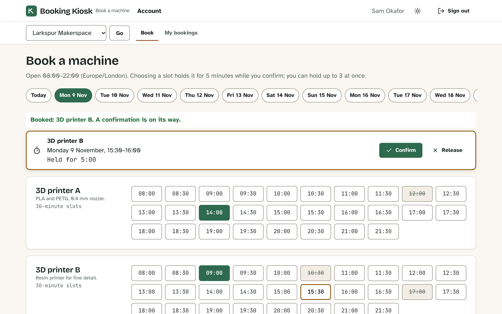

# Booking Kiosk

[](https://github.com/Nawfaldev19/rails-booking-kiosk/actions/workflows/ci.yml)
[](LICENSE)

Machine booking for community makerspaces: members hold slots that cannot collide, staff run a front-desk kiosk, and each space keeps its data to itself. Built to show how to make double booking and cross-tenant leaks impossible in the database, not just in application code.

**Live demo:** TODO: add the member app and kiosk URLs after deploying (steps in [DEPLOY.md](DEPLOY.md)). Until then, `docker compose up` runs it locally.



## Key decisions and trade-offs

- **No double booking under any concurrency.** A Postgres [exclusion constraint](api/db/migrate/20261017010100_create_machines_and_bookings.rb) refuses overlapping active bookings from every writer; a [real-thread spec](api/spec/services/concurrency_spec.rb) races eight members for one slot and a [Playwright test](web/e2e/member.spec.ts) has two browsers click it at once.
- **Tenant isolation at two layers.** Resolvers reach data only through [`Tenant`](api/app/models/tenant.rb), and composite foreign keys stop any record pointing into another workspace, even from raw SQL ([isolation attacks](api/spec/requests/tenant_isolation_spec.rb)).
- **Holds that expire exactly, without a scheduler**, with a countdown on the server's clock measured from live responses only ([`serverClock.ts`](web/packages/api/src/serverClock.ts), [ADR 0002](docs/adr/0002-holds-expire-lazily-and-count-down-on-the-server-clock.md)).
- **Managers never know anyone's password.** New staff get a single-use, expiring [invitation](api/app/models/invitation.rb) through a [transactional outbox](api/app/services/messages/deliver.rb) that claims with `SKIP LOCKED` and retries with backoff.
- **Safe, cheap templates.** Workspace wording in strict [Liquid](api/app/models/message_renderer.rb) with an allow-list, bounded input and a linear-time range check.
- **Cookie sessions, same-origin clients.** No token handling in JavaScript and no CORS. The price: a session cannot be revoked one by one (a password change revokes all), and any production proxy must forward `/graphql` and copy the security headers ([ADR 0007](docs/adr/0007-same-origin-clients-cookie-sessions-and-strict-headers.md)).
- **Read isolation by convention plus review.** The database enforces cross-workspace references, but reads rely on going through `Tenant`. Postgres row-level security is the next hardening step ([ADR 0003](docs/adr/0003-tenant-isolation-through-a-scoped-access-object-and-composite-keys.md)).
- **One typed contract.** A GraphQL schema where every element is described, a committed [SDL](api/schema.graphql), generated client types and typed payload errors.

## Quick start

```bash
docker compose up          # or, with Ruby 3.4, Node 22.12+ and Postgres: make setup && make dev
```

Open the member app at <http://localhost:5173> and the kiosk at <http://localhost:5174>. Every demo account is fictional and uses the password `booking-kiosk-demo-pass`; the sign-in pages have one-click buttons.

| Account | Role |
|---|---|
| `sam@example.com` | Member of both workspaces |
| `robin@example.com` | Manager, Larkspur Makerspace |
| `jules@example.com` | Front-desk staff, Larkspur Makerspace |
| `alex@example.com` | Member, Wharf Street Workshop |

A guided first booking: [tutorial](docs/tutorials/getting-started.md).

## Features

| ID | Feature | |
|---|---|---|
| F-01 | Sign-in, sessions with idle and absolute expiry, password change | [details](docs/reference/features.md#f-01-sign-in-sessions-and-passwords) |
| F-02 | Workspaces, per-workspace roles and isolation | [details](docs/reference/features.md#f-02-workspaces-roles-and-isolation) |
| F-03 | Slot grid and day strip in the workspace's time zone | [details](docs/reference/features.md#f-03-slot-grid-and-day-strip) |
| F-04 | Expiring holds that cannot collide | [details](docs/reference/features.md#f-04-expiring-holds-that-cannot-collide) |
| F-05 | Confirming, cancelling and My bookings | [details](docs/reference/features.md#f-05-confirming-cancelling-and-my-bookings) |
| F-06 | Front-desk kiosk | [details](docs/reference/features.md#f-06-front-desk-kiosk) |
| F-07 | Machine management | [details](docs/reference/features.md#f-07-machine-management) |
| F-08 | Team management and invitations | [details](docs/reference/features.md#f-08-team-management-and-invitations) |
| F-09 | Message templates with a live preview | [details](docs/reference/features.md#f-09-message-templates) |
| F-10 | Outbox and message delivery | [details](docs/reference/features.md#f-10-outbox-and-message-delivery) |
| F-11 | Usage report | [details](docs/reference/features.md#f-11-usage-report) |
| F-12 | Housekeeping task | [details](docs/reference/features.md#f-12-housekeeping-task) |
| F-13 | Typed, self-documenting GraphQL API | [details](docs/reference/features.md#f-13-typed-self-documenting-graphql-api) |
| F-14 | Accessible states, themes, layouts and protective headers | [details](docs/reference/features.md#f-14-accessible-states-themes-layouts-and-protective-headers) |

More screenshots: [dark theme](docs/assets/screenshot-member-dark.png), [template editor](docs/assets/screenshot-templates.png), [kiosk on a phone](docs/assets/screenshot-kiosk.png).

## Tech stack

Rails 8.1 (API mode) with graphql-ruby, PostgreSQL and Liquid; React 19, TypeScript, Vite, Apollo Client 4 and React Router 7; RSpec, Vitest in Chromium and Playwright. Why each was chosen: [architecture](docs/explanation/architecture.md#4-solution-strategy).

## Testing

`make verify` runs RuboCop, RSpec, ESLint, Knip, Prettier, `tsc`, Vitest, both builds and Playwright. Last full run recorded in the [test strategy](docs/testing/strategy.md): 171 RSpec examples, 61 Vitest tests (22 unit, 39 component, in Chromium) and 25 Playwright runs, all passing; API line coverage 98.88%. Running the web unit tests alone (`cd web && npx vitest run --project unit`) takes a second.

## What I would do next

- Postgres row-level security under `Tenant`, so reads are protected by the database too.
- Per-session revocation (a session table) instead of revoking all sessions on a password change.
- A real mail provider; the demo writes invitations to files.
- A shared cache for the rate limiter; today it is per process.

## Documentation

The [documentation map](docs/README.md) has a tutorial, how-to guides, reference (features, API, data model, configuration) and explanation (architecture, concurrency and holds), plus the [decision records](docs/adr/README.md).

## Security

Report vulnerabilities privately as described in [SECURITY.md](SECURITY.md); design notes are in the [threat model](docs/security/threat-model.md).

## Accessibility

The target is WCAG 2.2 AA; what was checked and the known limits are in [ACCESSIBILITY.md](ACCESSIBILITY.md).

## Contributing

See [CONTRIBUTING.md](CONTRIBUTING.md) and the [Code of Conduct](CODE_OF_CONDUCT.md); questions go through [SUPPORT.md](SUPPORT.md).

## Author

Nawfal Imran · [GitHub](https://github.com/Nawfaldev19) · [LinkedIn](https://www.linkedin.com/in/nawfal-imran-886b13218)

## License

[MIT](LICENSE); third-party licences are listed in [THIRD_PARTY_NOTICES.md](THIRD_PARTY_NOTICES.md).
