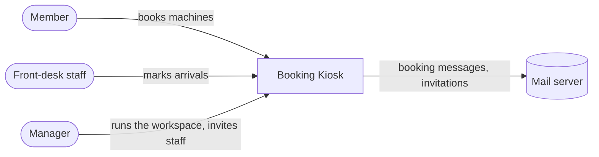
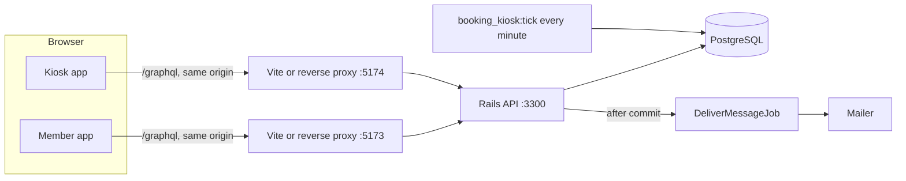
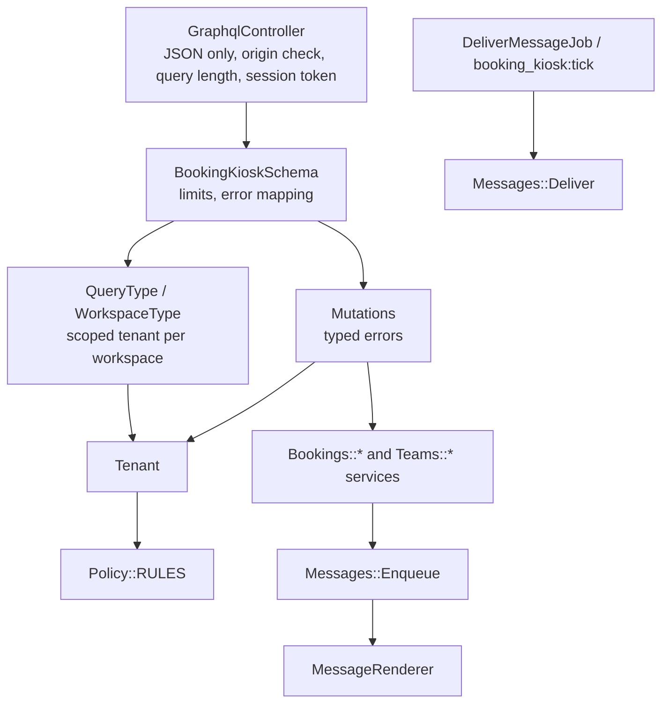
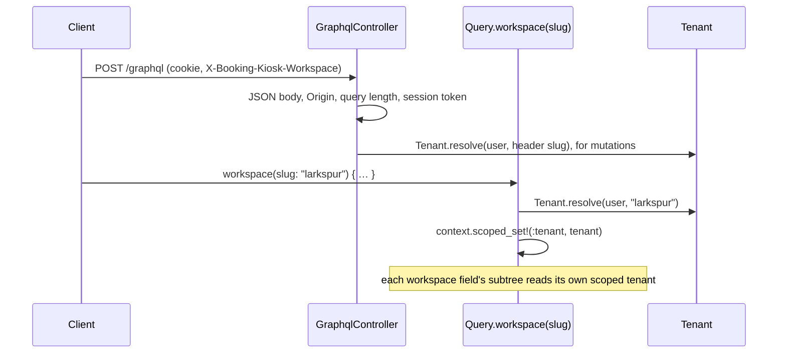

# Architecture

A light [arc42](https://arc42.org) description with [C4](https://c4model.com) diagrams at levels 1–3, drawn in Mermaid.

## 1. Goals

Booking Kiosk is a multi-tenant booking service for community makerspaces: members hold and confirm slots, front-desk staff mark arrivals, managers run their own space. Scope: [scope.md](scope.md).

| Priority | Quality goal | Achieved by | Verified by |
|---|---|---|---|
| 1 | No double booking, whatever the concurrency | Exclusion constraint; record locks for the hold limit and retirement | [`concurrency_spec.rb`](../../api/spec/services/concurrency_spec.rb), the two-browser test in [`member.spec.ts`](../../web/e2e/member.spec.ts) |
| 2 | Tenant isolation | `Tenant`, scoped GraphQL context, composite foreign keys | [`tenant_isolation_spec.rb`](../../api/spec/requests/tenant_isolation_spec.rb), [`constraints_spec.rb`](../../api/spec/db/constraints_spec.rb) |
| 3 | Exact hold expiry without a scheduler | `Booking.open_holds(now)` in every check | [`models_spec.rb`](../../api/spec/models/models_spec.rb) |
| 4 | Accessible (WCAG 2.2 AA target) | Skip links, live regions, managed focus, page titles, checked token contrast | component tests, [`responsive.spec.ts`](../../web/e2e/responsive.spec.ts), [ACCESSIBILITY.md](../../ACCESSIBILITY.md) |
| 5 | A schema change breaks the build, not production | Committed SDL, generated client types, typed errors | the SDL spec, CI codegen check, `tsc` |

## 2. Constraints

Rails 8.1 in API mode on Ruby 3.4; PostgreSQL 14 or later (range types, `btree_gist`, `citext`); React 19 with strict TypeScript; permissively licensed dependencies only ([THIRD_PARTY_NOTICES.md](../../THIRD_PARTY_NOTICES.md)); no payments or self sign-up; one region, one database, in-process jobs.

## 3. Context (C4 level 1)



## 4. Solution strategy

- The **database enforces invariants** that must hold under concurrency (exclusion constraint, composite keys, checks); violations become typed errors.
- **Resolvers are thin**: they call `Tenant` and one service per state change. Expected failures are data, not exceptions.
- **Side effects are transactional**: messages are recorded in an outbox with the change that causes them.
- **One origin per app** with cookie sessions: no token in JavaScript and no CORS.

| Tool | Why |
|---|---|
| Rails 8.1, graphql-ruby | Mature transactions and migrations, composite foreign keys, a code-first typed schema with connections and scoped context |
| PostgreSQL | Range types and exclusion constraints say "no overlapping bookings" directly |
| Liquid | Designed for untrusted template authors: no code execution, strict variables |
| React 19, Vite, Apollo Client 4, GraphQL Code Generator | Two small apps with a normalised cache and types generated from the SDL |
| RSpec, Vitest browser mode, Playwright | Specs on real Postgres, component tests in real Chromium, end-to-end tests on the whole stack |

## 5. Building blocks

### Containers (C4 level 2)



### Components of the API (C4 level 3)



Folders and dependency rules: [project-structure.md](../reference/project-structure.md).

## 6. Runtime view

### Hold, then confirm

The sequence and the race are in [concurrency-and-holds.md](concurrency-and-holds.md#hold-then-confirm).

### Outbox delivery

```mermaid
sequenceDiagram
  participant S as Service (confirm, cancel, invite)
  participant DB as Postgres
  participant J as DeliverMessageJob
  participant M as Mailer
  S->>DB: BEGIN; change; INSERT outbound_messages (rendered, pending); COMMIT
  S->>J: perform_later(message_id)
  J->>DB: claim: FOR UPDATE SKIP LOCKED; attempts + 1; 5-minute lease; COMMIT
  J->>M: deliver, with no transaction or lock held
  alt accepted
    J->>DB: delivered; an invitation's token is removed from the stored body
  else failed
    J->>DB: last_error; retry after 1, 2, 4 or 8 minutes; failed after 5 attempts
  end
```

A rollback leaves no message; a crash after commit leaves a pending one that `booking_kiosk:tick` delivers. Delivery is at least once ([ADR 0005](../adr/0005-transactional-outbox-for-messages.md)).

### Invitation

```mermaid
sequenceDiagram
  participant Mgr as Manager
  participant API as Rails
  participant DB as Postgres
  participant P as Invited person
  Mgr->>API: addTeamMember(name, email, role), no password
  API->>DB: user without password, membership, invitation (SHA-256 digest), outbox message with the link
  API-->>P: mail: /invitation#token=… (72 hours, one use)
  P->>API: acceptInvitation(token, password)
  API->>DB: lock invitation; set password; delete invitations
  API-->>P: session cookie
```

### Tenant scoping of a request



One request may name two workspaces through aliases; each subtree is scoped to its own tenant, so neither can read the other's records ([`tenant_isolation_spec.rb`](../../api/spec/requests/tenant_isolation_spec.rb)). A foreign ID is `NOT_FOUND`; signed out is `UNAUTHENTICATED`; not a member of the header's workspace is `FORBIDDEN`.

## 7. Deployment view

| Environment | How it runs |
|---|---|
| Docker Compose ([`docker-compose.yml`](../../docker-compose.yml)) | `db` (Postgres 16), `api` (Rails, seeds once), `scheduler` (`booking_kiosk:tick`), `web-install`, `member` and `kiosk` (Vite dev servers on fixed addresses, the only trusted proxies) |
| Local (`make dev`) | Rails, then both Vite dev servers; the API trusts the local proxies |
| End-to-end tests | Rails on 3301 with `booking_kiosk_e2e`, `vite preview` of both builds on 5273 and 5274 ([`playwright.config.ts`](../../web/playwright.config.ts)) |
| Production (not provided) | A reverse proxy serving both builds with the headers from [`security-headers.ts`](../../web/security-headers.ts), overwriting `X-Forwarded-For`, forwarding `/graphql`; `SECRET_KEY_BASE`, `DATABASE_URL`, SMTP settings and a shared cache |

## 8. Cross-cutting concepts

- **Validation** lives in one place per concern: models, `SlotRules`, `MessageRenderer`, and database constraints as the last line.
- **Errors:** `DomainError(code, message, field)`; mutations return `UserError`s, queries `extensions.code`. Internals are never rendered.
- **API conventions:** non-null by default; lists preload what they render, with constant query counts asserted by specs; the outbox pages by `(created_at, id)`; one JSON log line per operation, never variables.
- **Accessibility:** a skip link, a title per page announced after navigation, focus moved to the next sensible place when an action removes a control, status as icon plus text, one token set with light and dark values ([design-tokens.md](../reference/design-tokens.md)), applied before the first paint.
- **Time:** instants are `timestamptz`; workspace zones are applied when building opening hours and formatting ([concurrency-and-holds.md](concurrency-and-holds.md#time-zones)).
- **Client data:** the workspace comes from the URL (`/w/:slug`); an Apollo link adds `X-Booking-Kiosk-Workspace` to mutations and another records `serverTime` from live responses.
- **Security:** [threat model](../security/threat-model.md), [ASVS mapping](../security/asvs-mapping.md).

## 9. Decisions

[ADR index](../adr/README.md).

## 10. Risks and technical debt

| Risk or debt | Next step |
|---|---|
| Reads are isolated by convention plus review, not by the database | Policy-based security in Postgres ([ADR 0003](../adr/0003-tenant-isolation-through-a-scoped-access-object-and-composite-keys.md)) |
| Rate limiter and jobs are in-process | A shared cache and a durable job backend; the outbox already makes delivery retryable |
| Delivery is at least once | Provider-side deduplication on a message ID |
| An invitation token sits in the outbox body until delivery | Encrypt the column, or render the link at send time |
| People with bookings can only be demoted, not removed | Deactivate memberships instead of deleting them |
| CI does not start the Compose stack | A Compose smoke job |

## 11. Glossary

[glossary.md](../reference/glossary.md).
