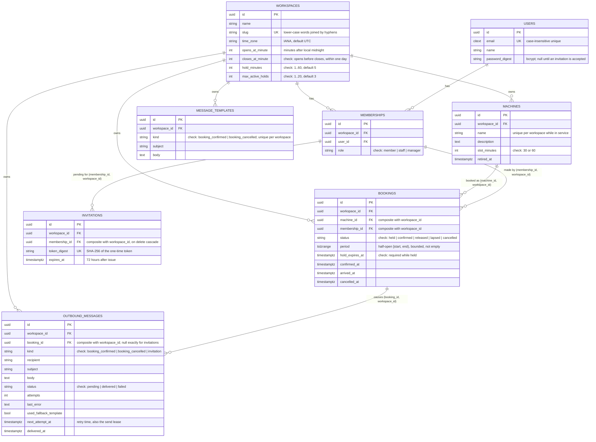

# Data model

Source of truth: [`api/db/schema.rb`](../../api/db/schema.rb), built from the [migrations](../../api/db/migrate). All primary keys are UUIDs (`gen_random_uuid()`), so IDs cannot be enumerated. Every datetime column is `timestamptz` ([`timestamptz.rb`](../../api/config/initializers/timestamptz.rb)), so a value means the same instant whatever the database server's time zone; the application runs in UTC and applies each workspace's zone when building opening hours and formatting.

## Constraints and why

| Constraint | Table | Rule | Why |
|---|---|---|---|
| `bookings_no_overlap` (exclusion, GiST) | bookings | `EXCLUDE USING gist (machine_id WITH =, period WITH &&) WHERE status IN ('held','confirmed')` | Two active bookings of one machine can never overlap, whatever code writes them. Needs `btree_gist` for the `=` on a UUID inside a GiST index. Half-open ranges let back-to-back slots touch. [ADR 0001](../adr/0001-prevent-double-booking-with-an-exclusion-constraint.md) |
| Composite foreign keys | bookings → machines, bookings → memberships, outbound_messages → bookings, invitations → memberships | `(child_id, workspace_id) → parent(id, workspace_id)` | A record cannot reference a parent in another workspace, even through raw SQL. Each parent has a unique index on `(id, workspace_id)` to make this possible. [ADR 0003](../adr/0003-tenant-isolation-through-a-scoped-access-object-and-composite-keys.md) |
| `bookings_period_bounded` | bookings | `NOT isempty(period) AND NOT lower_inf(period) AND NOT upper_inf(period)` | An empty or unbounded range would slip past the overlap check. |
| `bookings_holds_expire` | bookings | `status <> 'held' OR hold_expires_at IS NOT NULL` | Every hold must be able to lapse. |
| `bookings_status_valid`, `memberships_role_valid`, `message_templates_kind_valid`, `outbound_messages_status_valid`, `outbound_messages_kind_valid` | several | value lists | The database rejects unknown states even if the model enum is bypassed. |
| `outbound_messages_booking_matches_kind` | outbound_messages | `(kind = 'invitation') = (booking_id IS NULL)` | Booking messages always point at their booking; invitations never do. |
| Unique `token_digest`, cascade on membership delete | invitations | | A token identifies one invitation, and removing someone removes their open invitation. |
| `machines_slot_minutes_valid` | machines | `slot_minutes IN (30, 60)` | The grid and the alignment rule assume these lengths. |
| `workspaces_opening_hours_valid`, `workspaces_hold_minutes_range`, `workspaces_max_active_holds_range` | workspaces | ranges | Keeps the grid well-formed and the hold limit small enough to list without paging. |
| `citext` email, unique | users | case-insensitive uniqueness | `Sam@Example.com` and `sam@example.com` are one account in the database itself; the model also normalises (trim, lower-case). |
| Nullable `password_digest` | users | | An invited account has no password and cannot sign in until its owner chooses one. |
| Partial unique index on `(workspace_id, name) WHERE retired_at IS NULL` | machines | unique names in service | A retired machine's name can be reused. |
| `attr_readonly :workspace_id` | every workspace-owned model | application rule | A record never moves between workspaces; the composite keys back this up. |

## Indexes and the queries they serve

| Index | Serves |
|---|---|
| `index_bookings_on_workspace_and_start` on `(workspace_id, lower(period))` | the day sheet, usage and "upcoming" lists |
| `index_bookings_on_open_holds` on `hold_expires_at WHERE status = 'held'` | lapsing expired holds (`booking_kiosk:tick`, `PlaceHold`) |
| `index_bookings_on_membership_id_and_status` | a member's open holds (hold limit) and bookings |
| `bookings_no_overlap` (GiST) | overlap checks and the availability query |
| `index_outbound_messages_due` on `next_attempt_at WHERE status = 'pending'` | finding due messages in `booking_kiosk:tick` |
| `index_outbound_messages_on_workspace_id_and_created_at_and_id` | the outbox, newest first, paged by `(created_at, id)` |
| `index_invitations_on_token_digest` (unique) | accepting an invitation |

## Lifecycle of a booking

```mermaid
stateDiagram-v2
  [*] --> held: placeHold
  held --> confirmed: confirmBooking (before expiry and before the slot starts)
  held --> released: releaseHold
  held --> lapsed: expiry (read as LAPSED at once; stored by the next hold or booking_kiosk:tick)
  confirmed --> cancelled: cancelBooking (before start)
  confirmed --> confirmed: markArrival / undo (today only)
```

The constraints are exercised directly, bypassing the models, in [`api/spec/db/constraints_spec.rb`](../../api/spec/db/constraints_spec.rb).
