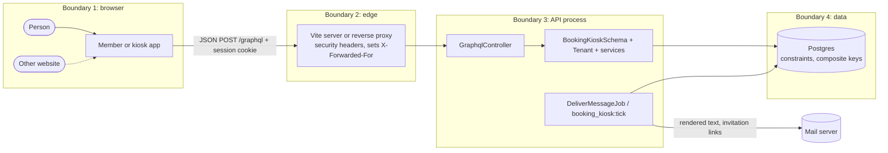

# Threat model

STRIDE per trust boundary. Reporting policy: [SECURITY.md](../../SECURITY.md); requirement-level view: [asvs-mapping.md](asvs-mapping.md); tests per control: [traceability.md](../testing/traceability.md#security-controls--tests).

## System and assets

Two single-page apps and one Rails GraphQL API, each app served from its own origin through a proxy that forwards `/graphql`, with Postgres behind the API. Sessions are encrypted HTTP-only cookies; messages go through an outbox.

Assets: members' bookings and contact details; password hashes, sessions and invitation tokens; workspace configuration, templates and the outbox; the integrity of the calendar; the API's availability.

Actors: members, staff and managers (authenticated, scoped to their workspaces); anonymous visitors; a member or manager of one workspace who wants another's data or another person's account; a hostile website in the same browser; a network attacker (production only, where TLS is assumed).

## Data flow and trust boundaries

## Boundary 1 → 2: browser to edge

| Threat | Mitigation | Where | Residual risk |
|---|---|---|---|
| **S** Cross-site request forgery | `SameSite=Lax` cookie; only `application/json` accepted; unknown `Origin` gets 403 | [`graphql_controller.rb`](../../api/app/controllers/graphql_controller.rb) | Low |
| **T/I** XSS in the apps | React escapes text; message bodies are plain text; strict Content Security Policy without `'unsafe-inline'`; the theme script is an external file | [`security-headers.ts`](../../web/security-headers.ts), [`theme-init.js`](../../web/public/theme-init.js) | Low; a production proxy must send the same policy |
| **T** Clickjacking | `X-Frame-Options: DENY`, `frame-ancestors 'none'` | apps and API | Low |
| **I** Cached data, referrer leaks, sniffing | `Cache-Control: no-store`, `Referrer-Policy: no-referrer`, `nosniff`, `Cross-Origin-Resource-Policy` (full list in [ADR 0007](../adr/0007-same-origin-clients-cookie-sessions-and-strict-headers.md)) | [`application.rb`](../../api/config/application.rb) | Low |
| **S** Session fixation or replay | Session reset on sign-in and sign-out; idle expiry signed into the cookie (2 hours); a session token valid 12 hours from sign-in and only until the password changes | [`graphql_controller.rb`](../../api/app/controllers/graphql_controller.rb), [`user.rb`](../../api/app/models/user.rb) | Sessions cannot be revoked one by one |
| **I** Invitation token leaking from the browser | The token sits in the URL fragment (never sent to a server or in `Referer`) and is removed from the address bar once read | [`AcceptInvitationPage.tsx`](../../web/apps/member/src/account/AcceptInvitationPage.tsx) | Mail clients may keep the message |
| **I** Session theft on the network | `Secure` cookie and forced TLS in production | [`production.rb`](../../api/config/environments/production.rb) | Depends on deployment |

## Boundary 2 → 3: edge to API

| Threat | Mitigation | Where | Residual risk |
|---|---|---|---|
| **S** Password guessing and credential stuffing | 10 failed attempts per account (normalised email) and 50 per client address per 5 minutes; successes refunded; `authenticate_by` takes the same time whether or not the email exists; bcrypt, 10–72 characters (72 bytes) | [`rate_limiter.rb`](../../api/app/models/rate_limiter.rb), [`sign_in.rb`](../../api/app/graphql/mutations/sign_in.rb) | Anyone can pause sign-in for one account for up to five minutes (accepted) |
| **S** Spoofed client address to dodge the per-address limit | `X-Forwarded-For` is ignored unless the socket peer is listed in `TRUSTED_PROXIES` (empty by default); the Vite proxies overwrite the header with the address they saw | [`client_address.rb`](../../api/app/models/client_address.rb), [`vite.app.ts`](../../web/vite.app.ts) | A production proxy must also overwrite the header |
| **D** Expensive or hostile queries | Query documents up to 10,000 characters, 1,000 tokens, depth 10, complexity 400, pages of at most 50; preloading for every list; introspection off in production | [`booking_kiosk_schema.rb`](../../api/app/graphql/booking_kiosk_schema.rb), [`graphql_controller.rb`](../../api/app/controllers/graphql_controller.rb) | No request-rate limit beyond passwords and invitations |
| **D** Slow template input (ReDoS) | Previews and saves bounded to 160 / 5,000 characters before parsing; the range check is linear; `Regexp.timeout` of one second | [`message_renderer.rb`](../../api/app/models/message_renderer.rb), [`regexp_timeout.rb`](../../api/config/initializers/regexp_timeout.rb) | Low |
| **T** Malformed input | JSON body; `variables` must be an object or JSON string (400 otherwise); typed arguments; model validations | [`graphql_controller.rb`](../../api/app/controllers/graphql_controller.rb) | Low |
| **R/I** Who did what, without leaking secrets | One structured log line per operation (request ID, operation, user, workspace); the parameter log drops `variables` and replaces every string literal in `query` | [`filter_parameter_logging.rb`](../../api/config/initializers/filter_parameter_logging.rb) | No audit table |

## Boundary 3 → 4: API to database

| Threat | Mitigation | Where | Residual risk |
|---|---|---|---|
| **I/T** Cross-tenant read or write with foreign IDs | Data reached only through `Tenant`; foreign IDs are `NOT_FOUND`; each `workspace(slug:)` subtree is scoped to its own tenant; composite foreign keys | [`tenant.rb`](../../api/app/models/tenant.rb), [`query_type.rb`](../../api/app/graphql/types/query_type.rb) | Reads rely on convention plus review |
| **E** A member calling manager operations | One role table; every service and resolver starts with `tenant.authorize!` | [`policy.rb`](../../api/app/models/policy.rb) | Low |
| **E** A manager taking over an account used in another workspace | Managers never choose or see passwords: new accounts get a single-use, 72-hour invitation whose digest alone is stored; the outbox shows the token as `hidden` and drops it after delivery; existing accounts join only with their own password | [`add_team_member.rb`](../../api/app/graphql/mutations/add_team_member.rb), [`invitation.rb`](../../api/app/models/invitation.rb), [ADR 0008](../adr/0008-invite-team-members-to-choose-their-own-password.md) | The token is stored in the outbox body until delivery |
| **E** Departed staff keeping access | Managers remove people or demote them to Member; access ends with the next request; nobody can change their own membership, so a workspace keeps a manager | [`app/services/teams`](../../api/app/services/teams) | People with bookings can only be demoted |
| **I** Learning who has an account | Probing needs a manager role; a wrong password reveals no name; new-account invitations are limited to 20 per workspace per hour | [`add_team_member.rb`](../../api/app/graphql/mutations/add_team_member.rb) | A manager can tell an email has an account, as any sign-up form can |
| **T** Double booking through races | Exclusion constraint; per-member lock for the hold limit; machine lock for retirement | [`place_hold.rb`](../../api/app/services/bookings/place_hold.rb) | Low |
| **T** SQL injection | Active Record with bound parameters; SQL fragments take `?` placeholders | model scopes | Low |
| **D** Filling the calendar | Holds only within 14 days, on aligned whole-minute starts, at most `max_active_holds` per member | [`slot_rules.rb`](../../api/app/services/bookings/slot_rules.rb) | Low |

## Boundary 3 → mail

| Threat | Mitigation | Where | Residual risk |
|---|---|---|---|
| **E/D** Template injection or exhaustion by a manager | Liquid (no Ruby), strict variables and filters, an allow-list, branching tags only, ranges refused, render limits | [`message_renderer.rb`](../../api/app/models/message_renderer.rb) | Low |
| **I** Mail to the wrong person | The recipient is the booking member's or invitee's own email, captured when the message is recorded | [`enqueue.rb`](../../api/app/services/messages/enqueue.rb) | Low |
| **R** Lost or duplicated messages | Transactional outbox, claim with lease, retries with backoff | [`deliver.rb`](../../api/app/services/messages/deliver.rb) | A crash after sending can duplicate one message |
| **I** Mail silently written to disk in production | Production needs `SMTP_ADDRESS` or an explicit `MAIL_DELIVERY=file`, or it refuses to boot | [`production.rb`](../../api/config/environments/production.rb) | Low |

## Supply chain and repository

| Threat | Mitigation | Residual risk |
|---|---|---|
| Malicious or vulnerable dependency | Lockfiles, `npm ci`, Dependabot, dependency review, blocking production `npm audit`, SBOM ([supply-chain.md](supply-chain.md)) | One accepted dev-only advisory |
| Compromised CI action | Actions pinned to commit SHAs; `persist-credentials: false`; read-only token | Low |
| Secrets in the repository | No credentials file; `SECRET_KEY_BASE` from the environment; `.env*` ignored | The owner should enable secret protection ([how-to](../how-to/enable-repository-security-features.md)) |

## Abuse cases

1. **Peek at another makerspace:** `workspace(slug: "larkspur")` from a Wharf Street member returns null; foreign IDs are `NOT_FOUND`.
2. **Guess Robin's password:** `RATE_LIMITED` after 10 failures for that account and 50 per client address, whatever `X-Forwarded-For` claims.
3. **Template bomb:** `` is refused on save; 100,000 characters of `{{` are refused by length before any parsing.
4. **Keep a former colleague's account:** a manager never knows an invitee's password, so leaving or changing workspaces cuts the manager off.

## Next steps

- Policy-based security in Postgres for a database-enforced read barrier per workspace ([ADR 0003](../adr/0003-tenant-isolation-through-a-scoped-access-object-and-composite-keys.md)).
- A shared cache store for the rate limiter in a multi-process deployment.
- Invitations for existing accounts, and password reset by email.
