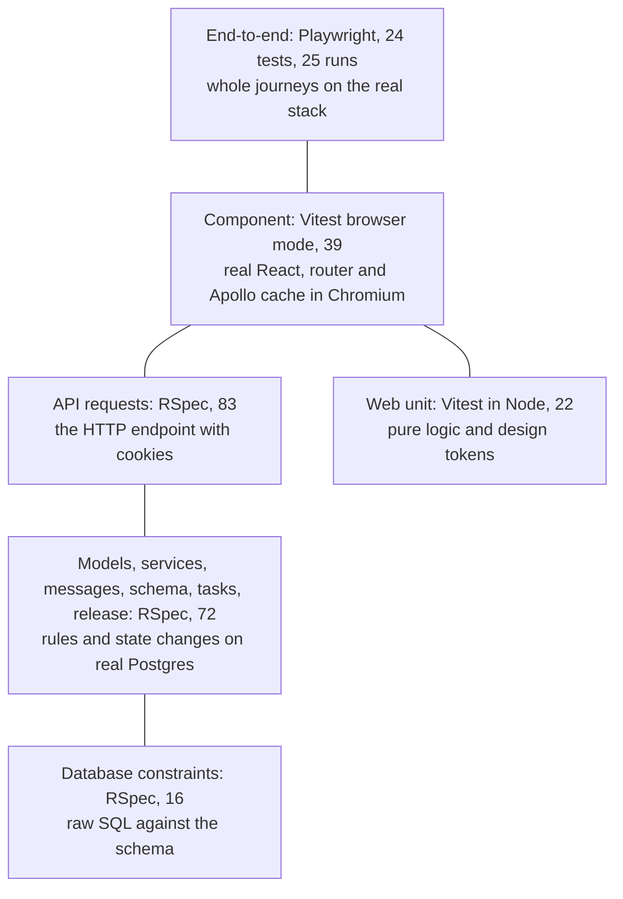

# Test strategy

This page is the single place for test counts and coverage. Which tests cover which feature: [traceability.md](traceability.md).

## Levels

Everything runs against a real database and a real browser ([ADR 0010](../adr/0010-test-against-a-real-database-and-browser.md)): constraints, record locks and focus cannot be proven with mocks.

## Suites

| Suite | Count | What it proves |
|---|---|---|
| `api/spec/db` | 16 | The exclusion constraint, composite tenant keys (also through `insert_all` and `update_all`), check constraints, the outbox's booking-or-invitation rule, and invitations deleted with their membership. |
| `api/spec/models` | 18 | Opening hours across daylight saving, validations (including bcrypt's 72-byte limit), the hold-expiry boundary, `Tenant`, the rate limiter's refund, `ClientAddress`. |
| `api/spec/services` | 35 | Every booking transition and slot rule (29), and 6 real-thread races: eight members for one slot, the hold limit, a confirmed booking, retirement during holds, two delivery workers, two managers demoting each other. |
| `api/spec/messages` | 14 | Strict Liquid, fallback, branching tags only, range bombs, the linear-time range check, the length bound, outbox snapshots, claim-then-send, backoff. |
| `api/spec/requests` | 83 | Transport and sessions (26), team and invitations (25), workspace flows (21), tenant isolation (8), response headers (3). |
| `api/spec/graphql`, `tasks`, `release` | 5 | Every schema element is described; `booking_kiosk:tick`; the SDL is current; one version everywhere. |
| `web/tests/unit` | 22 | Time zones and formatting, the countdown, the day sheet, slot presentation, URL parsing, error helpers, the server-clock store and link, design-token contrast. |
| `web/tests/component` | 39 | Sign-in, the hold tray (including a stale cached clock), the booking grid, My bookings, the team, account, invitation and messages pages, machines, outbox and the kiosk. |
| `web/e2e` | 24 tests: 22 desktop (one also on the `mobile` project) and 2 `tablet` | The real stack: hold, confirm, cancel; two browsers on one slot; isolation; the workspace switcher and page titles; machines, templates, outbox and usage; invitation, password change and removal; the kiosk; security headers with zero policy violations; the saved theme before scripts run; no sideways scrolling at 375px and 768px; focus never under the hold tray. |

**Latest run (2026-10-18, `make verify`, Ruby 3.4.11):** RuboCop clean (130 files); **RSpec 171 examples, 0 failures**; **Vitest 61 tests (22 unit, 39 component)**; **Playwright 25 runs (22 desktop, 1 mobile, 2 tablet)**, all passing. ESLint, Knip, Prettier, `tsc` and both builds were clean.

## Coverage

- **API:** SimpleCov reports **98.88% line coverage** (1153 / 1166). The suite fails below 90% ([`rails_helper.rb`](../../api/spec/rails_helper.rb)). The uncovered lines are defensive branches such as the rate limiter's cache-miss path.
- **Web:** V8 coverage of unit and component tests is **75.13% of lines** (571 / 760). Pages exercised only by Playwright, the app shells and the Apollo client factory do not count, so the figure is reported, not enforced.

## Determinism

- RSpec pins the clock to Tuesday 10 March 2026, 12:00 UTC ([`pinned_clock.rb`](../../api/spec/support/pinned_clock.rb)) and runs in random order. Concurrency specs commit for real and truncate afterwards. The test database is never seeded.
- Vitest component tests fake `Date` and `setInterval` where time matters and reset the server-clock offset before each test.
- Playwright reseeds a dedicated `booking_kiosk_e2e` database at start-up, runs serially with no retries, and uses distinct slots per test. The invitation test reads the delivered message from `api/tmp/mails`.
- Seeded people and places are fictional; every email is `@example.com`.

## How to run

[how-to/run-the-tests.md](../how-to/run-the-tests.md).

## CI

[`ci.yml`](../../.github/workflows/ci.yml) runs four jobs on pushes to `main` and on pull requests:

| Job | Runs |
|---|---|
| `api` | RuboCop, `db:prepare`, RSpec with coverage, SDL freshness |
| `web` | codegen freshness, ESLint, Knip, Prettier, `tsc`, Vitest with coverage, builds |
| `supply-chain` | blocking production `npm audit`, report-only full audit, CycloneDX SBOM |
| `e2e` | Playwright on the full stack |

[Dependency review](../../.github/workflows/dependency-review.yml) runs on pull requests, and [Scorecard](../../.github/workflows/scorecard.yml) on `main` and weekly.

## Known gaps

- CI does not start the Docker Compose stack, so the Compose file is checked only by parsing it.
- No load test: concurrency guarantees rest on the database constraint and the thread specs.
- Mail delivery is tested with ActionMailer's test and file delivery methods, not a real provider.
- No manual screen-reader testing has been recorded.
